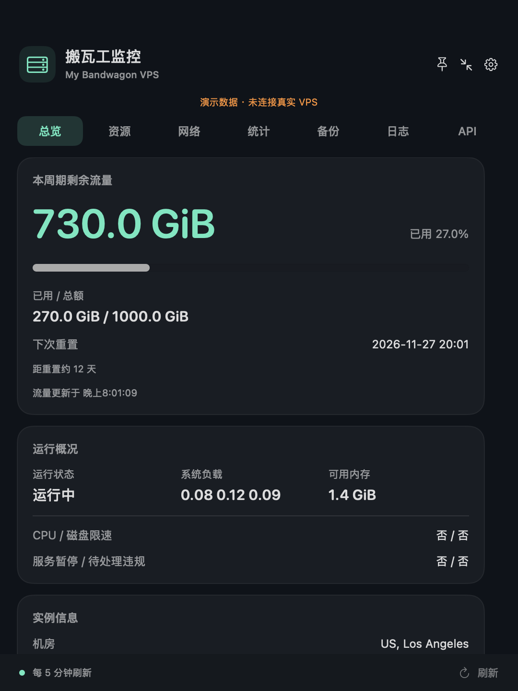
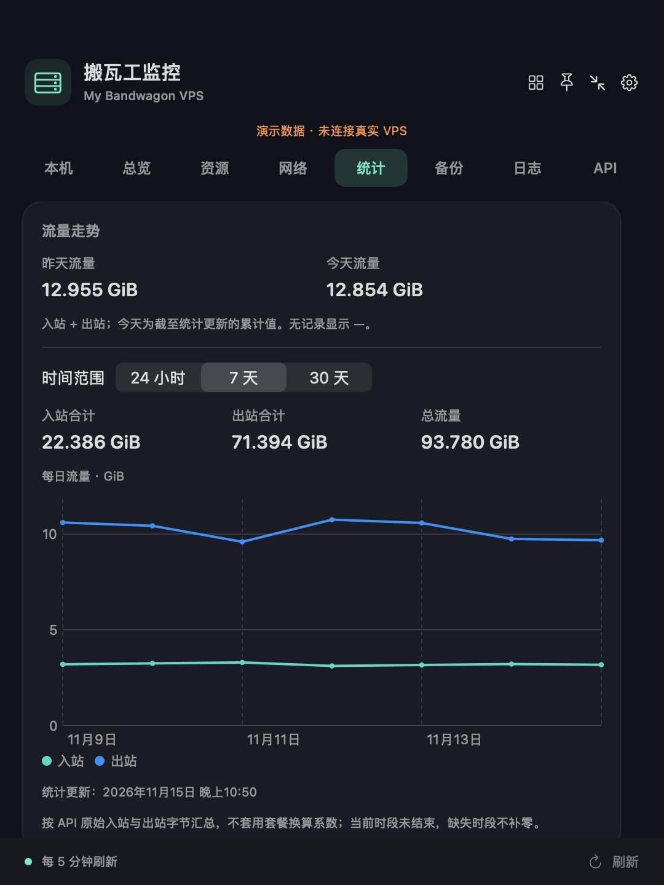
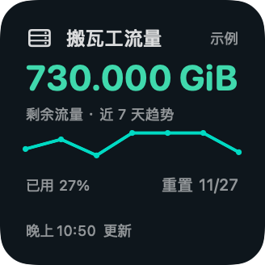
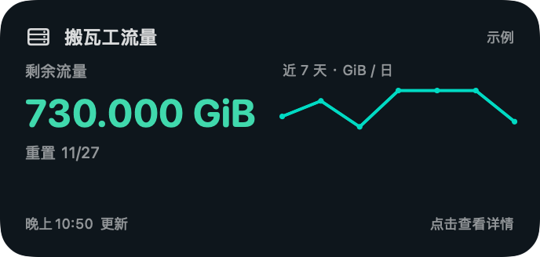
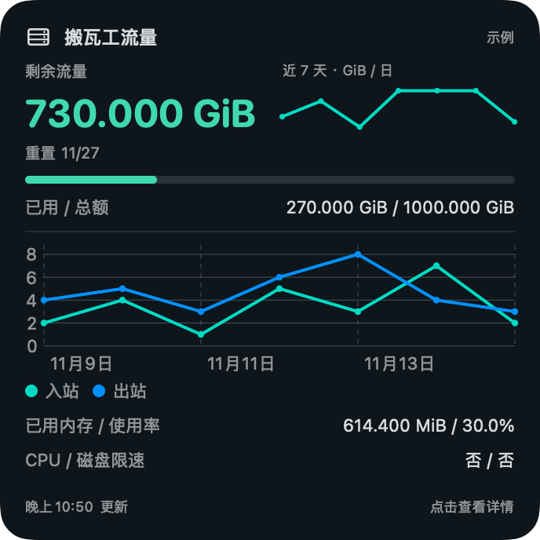
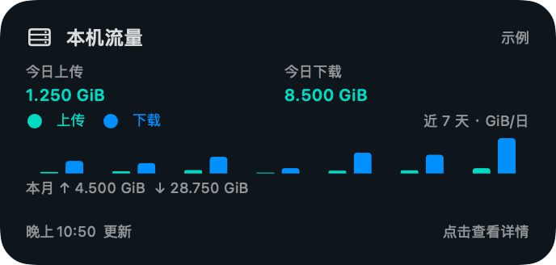
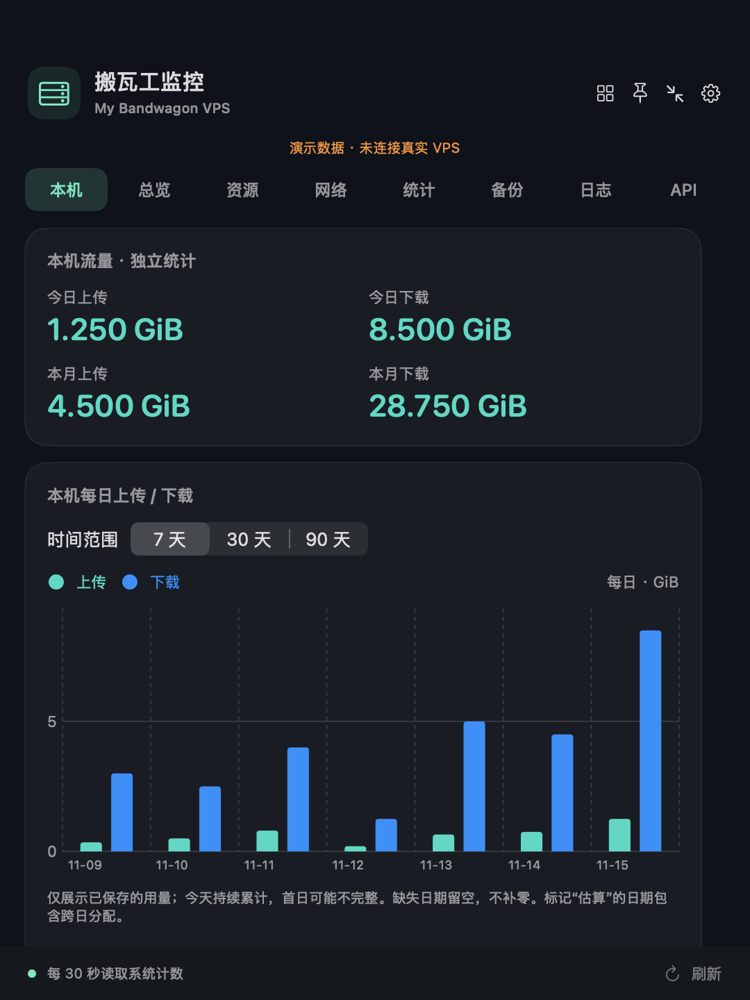
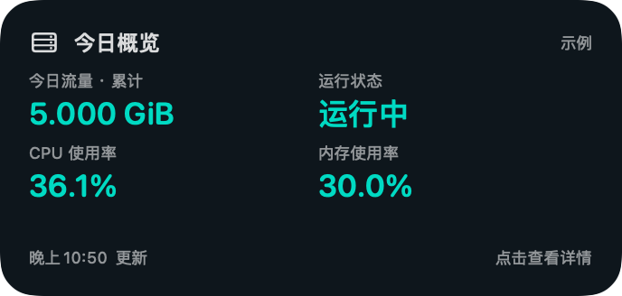
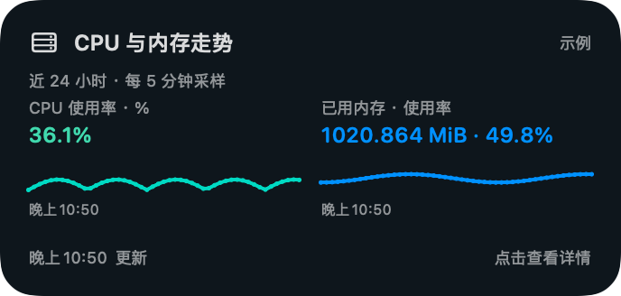
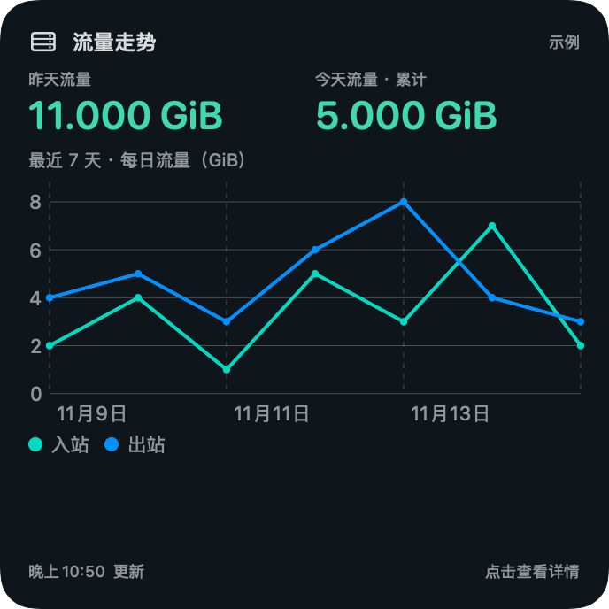

# 搬瓦工监控 · Bandwagon Monitor

原生 macOS VPS 监控工具，包含 WidgetKit 桌面小组件、流量走势图和后台自动更新。使用搬瓦工 KiwiVM API，仅调用查询接口。

## 演示截图

**下列图片全部由合成数据生成，不是任何真实 VPS 的截图。** 图片内保留“演示数据”或“示例”标识。IP 使用文档示例地址 `192.0.2.10`、`2001:db8::/64`，域名及邮箱使用 `example.com`。

| 总览 | 流量统计 |
| --- | --- |
|  |  |

| 小尺寸流量组件 | 中尺寸流量组件 | 大尺寸流量组件 |
| --- | --- | --- |
|  |  |  |

| 本机流量（独立于 VPS） | 本机统计页 |
| --- | --- |
|  |  |

| 流量预算 | 今日概览 |
| --- | --- |
|  |  |

| 资源组件 | 独立走势图组件 |
| --- | --- |
|  |  |

<details>
<summary>更多演示截图</summary>

- [添加小组件指引](docs/screenshots/widget-guide.png)
- [大尺寸流量预算](docs/screenshots/widget-10.png)
- [大尺寸今日概览](docs/screenshots/widget-12.png)
- [资源详情](docs/screenshots/resources.png)
- [网络详情](docs/screenshots/network.png)
- [迷你悬浮窗](docs/screenshots/mini-window.png)
- [大尺寸资源组件](docs/screenshots/widget-4.png)
- [中尺寸网络组件](docs/screenshots/widget-5.png)
- [大尺寸网络组件](docs/screenshots/widget-6.png)
- [中尺寸走势图组件](docs/screenshots/widget-7.png)

</details>

## 功能

- 剩余／已用／总流量、使用比例、重置时间。
- 24 小时、7 天、30 天入站与出站流量走势图；统计页和走势图小组件显示昨天／今天累计流量。
- 运行状态、负载、内存、Swap、磁盘映射空间、CPU 与磁盘限速。
- IP、机房、反向 DNS、黑洞记录、备份、快照、审计与违规记录。
- 流量、资源、网络、独立走势图、流量预算、今日概览及本机流量七种原生桌面小组件。
- APP 总览显示今日概览与流量预算；顶部四宫格按钮提供全部卡片的模拟预览和添加指引。
- 登录后自动启动、菜单栏显示开关、窗口置顶与迷你模式。
- 排他进程锁防止自动启动与手动打开产生多个实例。
- API Key 保存在 macOS 钥匙串；共享给小组件的仅为监控快照。

## 构建

要求 Apple Silicon Mac、macOS 14+、完整 Xcode 及 Swift 工具链。当前构建脚本输出 arm64；其他架构尚未验证。

真实桌面小组件需要使用自己的开发签名与团队标识。仓库不包含开发证书、团队 ID、签名文件或已签名应用。

```sh
export SIGN_IDENTITY='Apple Development: YOUR NAME (YOUR CERTIFICATE ID)'
export TEAM_ID='YOUR_TEAM_ID'
./build.sh
```

应用生成于 `dist/搬瓦工监控.app`。脚本会编译主应用与嵌入式扩展、签名、运行本地检查，并验证共享容器读写。macOS App Group 使用团队前缀形式；权限文件在忽略的构建目录生成。

安装或升级时运行：

```sh
./scripts/install.sh
```

安装脚本会先停止目标应用及其小组件进程，再替换文件并注册扩展，保留已有连接和偏好。升级时请先保存设置；脚本不会重置其他应用的小组件。

打开应用并填写 KiwiVM API 页中的 VEID 与 API Key。然后在桌面右键 → **编辑小组件** → 搜索 **搬瓦工监控**。在右侧向下滚动寻找卡片；「流量预算」「今日概览」支持中、大尺寸。APP 顶部四宫格按钮或总览中的「添加桌面小组件 · 查看指引」可查看名称、尺寸和模拟预览。

扩展构建保留 `_NSExtensionMain` 入口及 Swift `_main` 符号；删除相应链接参数可能导致扩展注册成功但启动崩溃。

### 设置与运行

- “登录后自动启动”通过 `SMAppService` 管理。若显示等待系统允许，可从设置中的按钮打开系统登录项设置。
- 关闭“在菜单栏显示”只隐藏图标；点击桌面小组件或重新打开应用仍可进入详情。
- 设置页的“退出应用”会结束后台更新，直到再次打开或下次登录；不会自动关闭登录启动偏好。
- 默认每 5 分钟更新总览（跟随设置中的自动刷新间隔），流量与 CPU 历史统计固定每 5 分钟拉取；成功写入数据后通知小组件刷新。小组件也每 5 分钟请求重新读取数据，实际显示时间由 macOS 调度。手动刷新可立即请求。
- WidgetKit 的屏幕刷新由 macOS 调度，不能保证与 API 轮询同时发生。关机、休眠、断网时无法持续拉取；唤醒后会触发刷新。
- 当前支持单台 VPS，不包含系统推送通知、账单查询或网络连通性探测。

- CPU 使用率与内存统计固定每 5 分钟刷新，不受总览刷新间隔影响；应用资源页、统计页和「CPU 与内存走势图」小组件显示最近 24 小时走势。该卡片原名「VPS 资源」，已有卡片会继续更新；添加时请选择中或大尺寸。

## 本机流量

APP 的「本机」页和「本机流量」中/大尺寸小组件显示本机今日、本月的上传与下载，和 VPS 流量独立。不要求配置 VPS。APP 新增每日上传/下载双柱状图，支持 7／30／90 天和可展开的每日明细；小组件显示最近 7 天。绿色为上传，蓝色为下载。图表按记录时区分日，今天持续累计；只显示已记录日期，不把缺失日期补成零。跨日分配的估算标记会保留在每日明细中。

使用 macOS 自带 `sysctl(NET_RT_IFLIST2)` 读取网卡 64 位累计收发字节，通过 `SystemConfiguration` 识别 Wi-Fi / 有线网卡（en 系列）。每 30 秒读取一次前后差值，不是逐秒累加网速；不抓取数据包，不读取通信内容，不调用第三方工具。排除 utun、回环、桥接、AWDL 等虚拟/特殊接口，避免把隧道和物理网卡重复相加。统计包含局域网和协议开销，不等于本机经过 VPS 的用量。

首次读数只设基线，开始前的用量不会追溯。历史在本机共享容器 `local-traffic-history.json` 按日保存，采用开始记录时的系统时区；界面显示记录起点及时区。跨日/跨月的采样间隔按时间比例分摊，归属可能含估算；保持后台运行可缩短这类间隔。应用退出后，若仍是同次系统启动且网卡计数连续，重新打开能补回增量；系统重启、网卡更换或计数重置造成的未知区间不补算。计数器下跌会重新设基线，已有日/月历史保留。

本机采样独立于 VPS 刷新；小组件约每 5 分钟请求更新，实际显示仍由 macOS 调度。历史文件不上传，不纳入源码或演示截图。

## 统计口径

容量使用 KiB / MiB / GiB。套餐额度与当前用量均按 `monthly_data_multiplier` 换算。

走势图使用历史接口的原始 `network_in_bytes` 与 `network_out_bytes`，不套用套餐换算系数。24 小时按小时、7/30 天按本地自然日汇总；当前时段尚未结束。缺失时段不补零、不跨缺口连线，同时间戳记录去重。空数据不绘制模拟曲线。

CPU 曲线直接使用 `getRawUsageStats` 的 `cpu_usage` 原始百分比与原始时间戳，不将系统负载换算成百分比；它是 API 统计时段的使用率，可能晚于当前时间。内存数据使用 `getLiveServiceInfo` 的 `plan_ram` 与 `mem_available_kb`：已用量＝套餐额度－可用内存，使用率＝已用量÷套餐额度；这是基于额度的统计口径。缺失或不合理数据不显示为零。内存历史从启用后累积，旧记录缺少额度时不倒推。CPU 与内存分别显示采样时间。历史按 VPS 隔离存放在本机共享容器的 `resource-history.json` 中，保留 30 天；不包含 API Key。重启恢复历史，切换 VPS 不混用数据。停机、休眠、退出、缺失字段或请求失败期间不补零，采样缺口不连线。

流量预算的每日均摊＝剩余额度÷距重置的天数（不足一天按一天）。重置前剩余预测＝当前剩余－近期日均用量×剩余天数。日均取过去 7 天中已结束且覆盖充分的本地自然日：按 5 分钟时段计覆盖率至少 90%，首尾缺口及相邻采样间隔不超过 15 分钟；不使用今天或不达标日期。预算历史用量应用与套餐相同的倍率，避免与额度混用单位；无有效日期或倍率时不做预测。预测是假设未来保持近期日均用量的估算，不是保证。

宿主机已映射磁盘空间不等同于系统内 `df` 的文件用量；虚拟机运行也不代表其中的服务可访问。

## 生成公开截图

```sh
./scripts/screenshots.sh
```

脚本以独立演示应用标识构建，不安装、不启用自动启动、不连接 VPS、不读取钥匙串。截图直接从演示视图渲染，不截取桌面。生成期间不显示演示窗口或菜单栏图标。

五张应用截图与九张小组件截图写入 [`docs/screenshots/`](docs/screenshots/)，中间产物在忽略的 `dist/` 中。演示版仅用于本地预览，不能当作正式小组件安装。

## 小组件白块的排查

如果升级后组件名称存在，但画面显示空白，可能是旧版扩展进程仍驻留，归档内容与系统登记版本不一致。不要只覆盖正在运行的 `.app`；使用安装脚本升级，然后关闭并重新打开“编辑小组件”。不需要删除 VPS 配置或重置整个系统的小组件数据库。

## 隐私与开源范围

仓库只有源码、原创图标、合成演示截图与文档。没有真实 VPS 配置、API 响应、钥匙串导出、系统日志、崩溃报告、真实统计快照或个人签名身份。

发布前运行：

```sh
python3 scripts/check-public-files.py
```

这项静态检查用于拦截常见隐私文件和个人路径，不能替代对新增内容的人工审查。请勿把包含账户数据的整个应用输出目录直接上传。

## 许可

[MIT License](LICENSE)。本项目是独立工具，与 BandwagonHost 无隶属关系。

API 入口：[KiwiVM 控制面板](https://kiwivm.64clouds.com/)。
